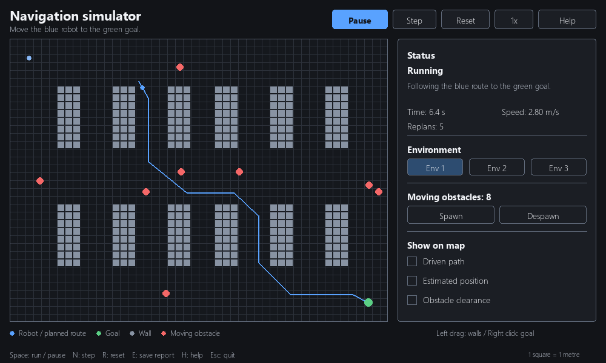

# 2D Navigation Simulator

A 2D autonomous navigation simulator built with Python and Pygame, with
interactive map editing, moving obstacles, and real-time visualization.



## Installation and launch

Requires Python 3.12. Install the dependencies and start the simulator:

```bash
python -m pip install -r requirements.txt
python grid.py
```

The simulator starts paused. Select **Run** or press **Space** to begin.
Three environment layouts are available: **Env 1**, **Env 2**, and **Env 3**.

## Interface overview

| Map element | Description |
| --- | --- |
| Blue marker and heading line | Robot position and orientation |
| Blue route | Planned path to the goal |
| Green circle | Goal |
| Gray squares | Walls |
| Red circles | Moving obstacles |

The sidebar displays simulation status, elapsed time, speed, and the number of
replans. The footer provides a color legend and keyboard shortcuts.

Optional overlays include **Driven path** (the recorded robot trajectory),
**Estimated position** (the filter's position estimate), and **Obstacle clearance**
(space around walls).

## Navigation overview

The robot uses A* path planning and waypoint control to navigate toward the
selected goal. The occupancy grid updates as obstacles move or the map is edited,
allowing the route to be recalculated as needed. Collision checks and obstacle
motion prediction help avoid contact. An extended Kalman filter estimates the
robot's position and heading from simulated noisy measurements.

If no route is available, the robot stops and retries. Modify the map, select
another goal, or reset the environment to continue. A detected collision ends
the current run.

## Controls

| Control | Action |
| --- | --- |
| Run / Pause / Space | Start or pause |
| Step / N | Advance one simulation step and pause |
| Reset / R | Restore the selected environment |
| Env 1 / Env 2 / Env 3 | Switch environments |
| Left click or drag | Add walls; start on a wall to erase |
| Right click | Move the goal |
| Shift + left click | Move the robot to an unoccupied location |
| Spawn | Add a moving obstacle with random position, direction, and speed |
| Despawn | Remove one random moving obstacle |
| Show on map | Toggle optional map views |
| C | Toggle obstacle clearance |
| Speed button | Cycle playback speed |
| Help / H / F1 | Open or close help; opening it pauses the run |
| E | Save a JSON report as `mission-report.json` |
| Esc | Close help or exit |

**Spawn** and **Despawn** are available while paused or running. **Reset** restores
the selected environment. After the robot reaches the goal or a collision is
detected, select **Restart** to begin a new run.
